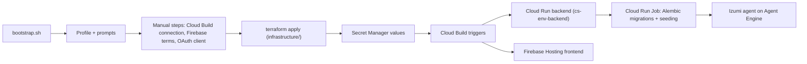

# 🚀 Creative Studio — Deployment Guide (Terraform + `bootstrap.sh`)

This guide explains, step by step, how Creative Studio is deployed into a Google Cloud project with the Terraform code in [`infrastructure/`](./infrastructure) orchestrated by [`bootstrap.sh`](./bootstrap.sh), what each step asks you for, how to re-run / resume / upgrade a deployment, and — most importantly — the **errors we have actually hit in real deployments and how to get out of them** (see [§6 Troubleshooting](#6-troubleshooting-known-errors-and-fixes)).

Related documents:

- [`README.md`](./README.md) — product overview and the 20‑minute quick start.
- [`DEVELOPMENT.md`](./DEVELOPMENT.md) — running Creative Studio locally with Docker Compose.
- [`infrastructure/README.md`](./infrastructure/README.md) — the **in-depth infrastructure diagram** (every GCP resource and how traffic, data and CI/CD flow between them) and the database **migration flow** (legacy public‑IP → private‑IP) in detail.
- [`docs/local-izumi/`](./docs/local-izumi) — running the Izumi agent locally.

---

## Table of contents

1. [How a deployment works](#1-how-a-deployment-works)
2. [Prerequisites](#2-prerequisites)
3. [Running the deployment, step by step](#3-running-the-deployment-step-by-step)
4. [Flags, profiles and non-interactive runs](#4-flags-profiles-and-non-interactive-runs)
5. [Redeploying, upgrading and migrating](#5-redeploying-upgrading-and-migrating)
6. [Troubleshooting (known errors and fixes)](#6-troubleshooting-known-errors-and-fixes)
7. [Running Terraform by hand](#7-running-terraform-by-hand)
8. [Tearing a deployment down](#8-tearing-a-deployment-down)
9. [Reference: files the script generates](#9-reference-files-the-script-generates)

---

## 1. How a deployment works

`bootstrap.sh` is a **resumable, interactive Bash script** (`set -e`: it stops at the first error and can simply be re-run). It does not replace Terraform — it wraps it:

1. Collects configuration interactively and stores it in a **deployment profile** (`~/.cstudio/profiles/<name>.cstudio_bootstrap.conf`) so later runs are mostly non-interactive.
2. Walks you through the few things that cannot be automated (Cloud Build host connection, accepting Firebase terms, the OAuth Web Client ID).
3. Generates `infrastructure/<env>.tfvars` and `infrastructure/<env>.backend.tfvars` and runs `terraform init` / `plan` / `apply` against a GCS state bucket.
4. Populates Secret Manager, triggers Cloud Build (backend → Cloud Run, frontend → Firebase Hosting).
5. Runs database migrations + seeding through a temporary Cloud Run Job inside the VPC.
6. Deploys the **Izumi agent** to Vertex AI Agent Engine and wires it to the backend.



### 1.1 What gets created

`<env>` is the environment name you choose (default `dev-infra`); `<project>` is the GCP project ID.

| Component | Name(s) | Created by |
| --- | --- | --- |
| Terraform state bucket | `<project>-cstudio-<env>-tfstate`, prefix `infra/<env>/state` | `bootstrap.sh` (Step 5) |
| VPC, subnet, Private Service Access range, firewall | `cs-<env>-vpc`, `cs-<env>-run-subnet` (`10.0.0.0/26`), `cs-<env>-psa-range`, `cs-<env>-allow-internal` | Terraform `modules/network` |
| Cloud SQL — PostgreSQL 18, **private IP only**, automated backups + PITR | instance `cs-<env>-db-<hex>`, database `creative_studio`, user `app_user`, password in secret `cs-<env>-db-password` | Terraform `modules/database` |
| Media/asset bucket | `<project>-cs-<env>-bucket` (an existing legacy `<project>-cs-*-bucket` is reused automatically) | Terraform `storage.tf` |
| Artifact Registry (Docker) | `cs-<env>-repo` | Terraform `modules/artifact` |
| Backend Cloud Run service | `cs-<env>-backend` — 2 vCPU / 8 GiB, min 1 instance, Direct VPC egress | Terraform `modules/compute` (the real image is deployed by Cloud Build; Terraform ignores image changes) |
| Service accounts | `cs-<env>-run` (backend runtime), `cs-<env>-agent` (Izumi), `cs-<env>-bkt-reader` (signed URLs), `cs-trig-sa` (Cloud Build triggers) | Terraform |
| Secret Manager "shells" | `FIREBASE_*` (7), `GOOGLE_CLIENT_ID`, `GOOGLE_TOKEN_AUDIENCE`, `agent_engine_resource_name`, `agent_engine_user_auth_token_key`, `workflow_token_encryption_key` — created with a placeholder version | Terraform creates them; `bootstrap.sh` writes the values |
| Firebase Hosting site + Web app | site = the project's default Hosting site (usually `<project>`), web app `cs-<env>-frontend` | Terraform (site) / `bootstrap.sh` (web app) |
| Cloud Build (2nd gen) | repository link to **your fork** + triggers `cs-<env>-backend-trigger` and `cs-<env>-frontend-trigger` (push to your branch, path-filtered to `backend/**` / `frontend/**`) | Terraform `ci_cd.tf` — **the host connection itself is created manually by you** |
| Temporary Cloud Run Job | `temp-db-bootstrap-job` (deleted automatically after a successful run) | `bootstrap.sh` (Step 14) |
| Vertex AI Agent Engine | `izumi-ads-x-agent` (its resource name is stored in the `agent_engine_resource_name` secret) | `bootstrap.sh` (Step 15) via Cloud Build |

Terraform also enables the required APIs (`infrastructure/variables.tf` → `apis_to_enable`) and never disables them on destroy.

---

## 2. Prerequisites

### 2.1 Accounts and permissions

- A Google Cloud project with **billing enabled** (the script can also create one for you if you provide a Billing Account ID).
- Your Google account needs **Owner** on the project (or an equivalent set of admin roles: Service Usage, IAM, Cloud SQL, Cloud Run, Cloud Build, Secret Manager, Storage, Firebase, Artifact Registry, Vertex AI).
- A **fork** of this repository on GitHub (or GitLab): <https://github.com/GoogleCloudPlatform/gcc-creative-studio/fork>. Cloud Build needs to install its app on that fork, so you must be allowed to install GitHub Apps on it.
- Google sign-in for the application is Firebase Authentication **with Identity Platform** and the **Google provider**. You enable the provider and click **Upgrade** (to Identity Platform) in the Firebase console during Step 6 (see below); the upgrade also creates the OAuth Web Client the script asks for, so there is nothing to create by hand in *APIs & Services → Credentials*.

### 2.2 Tools

The easiest environment is **Google Cloud Shell** — everything is pre-installed and pre-authenticated. On a workstation you need:

| Tool | Notes |
| --- | --- |
| `gcloud` | `gcloud auth login` **and** `gcloud auth application-default login` (Terraform uses Application Default Credentials). Cloud Shell has both already. |
| `git` | — |
| `jq` | The script offers to install it (`apt-get` / `brew` / `yum`). |
| `firebase-tools` | `npm install -g firebase-tools` (the script offers to do it) and `firebase login` on a workstation. |
| `uv` | Installed automatically if missing. |
| `terraform` | **1.14.1** is installed into `~/bin` automatically if missing or older (`REQUIRED_TERRAFORM_VERSION` in the script). The code requires ≥ 1.13.0 and the `google` / `google-beta` providers ≥ 7.0. |

### 2.3 Decisions to make before you start

| Decision | Default | Notes |
| --- | --- | --- |
| GCP project ID | active `gcloud` project | — |
| **Region** | `us-central1` | Pick a region allowed by your organisation policies (`constraints/gcp.resourceLocations`). Everything — state bucket, Cloud SQL, Cloud Run, secrets replicas, Agent Engine — is created in this region. |
| Environment name | `dev-infra` | Appears in every resource name (`cs-<env>-…`). One profile ⇔ one environment. |
| Branch to deploy | `main` | The Cloud Build triggers fire on pushes to **exactly** this branch of your fork. |
| Cloud SQL tier | `db-custom-2-7680` (Enterprise) | Option 2 `db-perf-optimized-N-2` switches the instance to Enterprise Plus; option 3 is any custom tier. |
| Cloud SQL availability | `ZONAL` | `REGIONAL` = multi-zone HA, roughly 2× the cost. |
| Cloud Build host connection name | — | You create it in the console (e.g. `gh-yourname-con`). **Create it in the deploy region and do not link the repository in the wizard** (see Step 6 and [§6.1](#61-terraform-fails-the-cloud-build-repository--connection-already-exists-409)). |

---

## 3. Running the deployment, step by step

### 3.1 Start the script

Run it from the directory that **contains (or will contain) your fork clone** — not from inside the repository. The script clones your fork into `./<repo-name>` (sparse checkout of `infrastructure`, `backend`, `frontend`, `bootstrap.sh`) and, on later runs, just `git pull`s it.

```bash
# first run (Cloud Shell or a prepared workstation)
curl https://raw.githubusercontent.com/GoogleCloudPlatform/gcc-creative-studio/refs/heads/main/bootstrap.sh | bash

# later runs (resume after a failure, upgrade, infra changes) — from the same parent directory
./gcc-creative-studio/bootstrap.sh --profile <profile-name>
```

When piping from `curl`, pass flags with `bash -s --`, e.g. `… | bash -s -- --profile default --auto-approve`.

Plan for roughly **20–40 minutes** of wall-clock time: the first `terraform apply` (Cloud SQL + VPC peering) takes 10–15 minutes, the two Cloud Build pipelines about 5–10 minutes, the Izumi deployment another ~10 minutes.

### 3.2 What each step does and what you answer

> [!NOTE]
> The banner numbers the script prints (`--- Step N: … ---`) are labels, not a strict sequence: "Step 2", "Step 8" and "Step 10" each appear twice. The table below is in **execution order**.

| # | Banner | What happens | What you must do / know |
| --- | --- | --- | --- |
| 1 | Step 1 — Checking Prerequisites | Verifies `gcloud`, `git`; offers to install `jq`, `firebase-tools`, `uv`. | Answer `y` to the install prompts if needed. |
| 2 | Step 2 — Selecting Deployment Configuration Profile | Lists `~/.cstudio/profiles/*.cstudio_bootstrap.conf`. With no profiles it creates `default`. With a loaded profile it shows the 11 stored parameters. | `1..n` to load, `N` to create, `D` to delete. On a loaded profile: `Y` accept, `e` edit one property, `n` reject. `--profile <name>` skips the menu. |
| 3 | Step 2 — Checking Terraform Installation | Installs Terraform 1.14.1 into `~/bin` if missing/older. | If it says "open a new terminal", do so and re-run. |
| 4 | Step 3 — Configuring Google Cloud Project | Uses the stored project, else offers the active `gcloud` project, else asks for an existing/new project ID (+ billing account for a new one). | — |
| 5 | Step 4 — Configuring Git Repository | Asks for **your fork URL** (validated with `git ls-remote`) and the **branch** (default `main`); sparse-clones it or pulls it. | Use the HTTPS URL of your fork, e.g. `https://github.com/<you>/gcc-creative-studio.git`. |
| 6 | Step 5 — Configuring Terraform Environment | Scans the project for an existing `<project>-cstudio-*-tfstate` bucket (auto-fills env name + state bucket so an existing deployment is updated, not duplicated) and for a legacy `<project>-cs-*-bucket` (reused as asset bucket). Asks environment name, region, DB tier, DB availability. Creates the state bucket and writes `<env>.backend.tfvars` + `<env>.tfvars`. | Enter the decisions from §2.3. The region must match `^[a-z]+-[a-z]+[0-9]+$` (e.g. `europe-west1`). |
| 7 | Step 6 — Manual Steps Required | Enables APIs. Then three manual items: **(a)** Cloud Build host connection, **(b)** Firebase terms + Authentication (Google provider, **Upgrade** to Identity Platform), **(c)** OAuth Web Client ID. | See the detailed instructions right below this table. |
| 8 | Step 7 — Automating Firebase Web App Configuration | Creates the Firebase web app `cs-<env>-frontend` if missing, reads its SDK config, resolves the Hosting site ID (the project's default site, else the first site, else the project ID) and writes it into the tfvars. | Fails with *"Could not automatically fetch Firebase API Key"* if Firebase is not linked to the project yet → finish Step 6 (b) and re-run. |
| 9 | Step 8 — Database Backup & Export | **No-op on a fresh project.** If a legacy V1 instance (`creative-studio-db[-<hex>]`) exists it offers to export it to `gs://<state-bucket>/migration_backup.sql.gz`. `--migrate-db` forces an export of whatever DB exists; `--use-existing-backup` skips the export and reuses the file. | Answer `y` only if you are upgrading a legacy V1 deployment. Details in [§5.4](#54-migrating-a-legacy-v1-public-ip-database). |
| 10 | Step 9 — Checking Migration Intent & Preparing Safe State | If a migration is planned (or an orphaned `migration_backup.sql.gz` is found and you accept), deploys the dummy image `us-docker.pkg.dev/cloudrun/container/hello` to the existing backend service(s) so Terraform's network changes cannot deadlock Cloud Run. | On the happy path it prints "No migration intent detected" and moves on. |
| 11 | Step 10 — Deploying Infrastructure with Terraform | `terraform init -reconfigure -upgrade -backend-config=<env>.backend.tfvars`, `terraform plan -detailed-exitcode -out=tfplan`. Exit 0 → "zero modifications", apply skipped. Exit 2 → asks for confirmation and runs `terraform apply -parallelism=30 tfplan`. | Review the plan and answer `y` (or pass `--auto-approve`). The first apply takes 10–15 min. |
| 12 | Step 10 — Importing Legacy Database (if applicable) | Only when a migration is in flight: grants the new instance's SA read access to the backup, **drops and recreates** `creative_studio` on the new instance, imports the dump, restarts the backend with its current image. | Nothing on the happy path. |
| 13 | Step 8 — Automating OAuth Secret Population | Writes the OAuth Web Client ID into `GOOGLE_CLIENT_ID` and `GOOGLE_TOKEN_AUDIENCE`. | — |
| 14 | Step 11 — Configuring OAuth Client URIs | Best-effort: tries to add the `*.web.app` / `*.firebaseapp.com` origins and `/__/auth/handler` redirect URIs to the OAuth client via `gcloud iap oauth-clients`. Only IAP-managed clients can be updated that way, so it frequently prints *"Could not resolve the full name for the OAuth client. Skipping URI update."*. | Harmless. If sign-in later fails, see [§6.9](#69-google-sign-in-fails-authunauthorized-domain-redirect_uri_mismatch-origin-not-allowed). |
| 15 | Step 12 — Updating Remaining Secrets | Writes the seven `FIREBASE_*` secrets from the SDK config. Generates `agent_engine_user_auth_token_key` **once** and keeps it on later runs (rotating it desyncs backend and agent). Generates the Fernet key `workflow_token_encryption_key` **once** as well (openssl → python3 → `/dev/urandom`) and keeps it on later runs ([§4.3](#43-resuming-after-a-failure)). `agent_engine_resource_name` is deferred to Step 15. | Any secret the script cannot discover is asked for interactively (input is hidden); if no Fernet generator is available it prints a `python3` one-liner to create the key on another machine. |
| 16 | Step 13 — Triggering Initial Builds | Runs `cs-<env>-backend-trigger` and `cs-<env>-frontend-trigger` on the **current branch of the clone**. | Answer `y`. `--force-builds` skips the question, `--skip-builds` skips the builds. Monitor at `https://console.cloud.google.com/cloud-build/builds?project=<project>`. |
| 17 | Step 14 — Executing Database Migrations & Initial Seeding | Waits for the backend build (≤ 30 min) or for a non-dummy image on the service (≤ 15 min). Creates `temp-db-bootstrap-job` from the live backend image inside the VPC subnet and runs `python -m bootstrap.bootstrap`: Alembic migrations, admin user, default public workspace, VTO assets and media templates. Deletes the job on success. | **The `gcloud` account you run the script with becomes the first ADMIN user** (`ADMIN_USER_EMAIL`). A failed job is **not fatal**: the job is left in place for inspection ([§6.6](#66-database-migrations--seeding-job-failed)). |
| 18 | Step 15 — Automated Izumi Agent Deployment | Clones `genmedia-izumi-agent` at `v0.2.1` (override with `IZUMI_AGENT_BRANCH=<tag>`), builds and deploys it to Agent Engine in the deploy region through Cloud Build (running as `cs-trig-sa`), resolves the newest engine named `izumi-ads-x-agent`, stores its resource name in `agent_engine_resource_name`, waits for the backend build and **re-deploys the backend on the same image** so the new revision reads the fresh secrets. | A Cloud Build failure here is reported as a warning; re-run the script to retry. |
| 19 | Step 16 — Deployment Complete | Prints the frontend (`https://<site>.web.app`) and backend URLs. | Builds may still be finishing; wait a few minutes. |

#### Step 6 in detail — the manual items

**(a) Cloud Build host connection.** The script asks *"Do you already have a Cloud Build Host Connection for GitHub in this project? (y/n)"*.

- If you do, type its name. If not, it prints the wizard URL `https://console.cloud.google.com/cloud-build/connections/create?project=<project>`.
- In the wizard: pick **GitHub** (or GitLab), choose the **same region as your deploy region**, name it (e.g. `gh-yourname-con`), authorize the Cloud Build GitHub App and grant it access to your fork.
- **Stop when the wizard offers to "Link repositories".** Terraform creates the repository link itself (`google_cloudbuildv2_repository.source_repo` in [`infrastructure/ci_cd.tf`](./infrastructure/ci_cd.tf)). If you link the fork in the wizard, `terraform apply` fails with a `409 already exists` — see [§6.1](#61-terraform-fails-the-cloud-build-repository--connection-already-exists-409).
- Paste the connection name back into the script; it is stored in the profile (`REPO_CONN_NAME`) and written to `repo_conn_name` in the tfvars. Terraform looks for `projects/<project>/locations/<region>/connections/<name>` — a connection created in another region is "not found" ([§6.2](#62-terraform-fails-cloud-build-connection-not-found-404)).

**(b) Firebase terms and Authentication.** Open `https://console.firebase.google.com/?project=<project>`, click **Add Firebase** to the existing project and accept the terms. Then set up the sign-in the app uses, in this order:

1. **Build → Authentication → Get started → Sign-in method → Google → Enable** (provide the support email it asks for) → **Save**.
2. Scroll to the bottom of the Authentication page and click **Upgrade** (*"Upgrade to Firebase Authentication with Identity Platform"*), then confirm. This switches the project to **Identity Platform** (the `identitytoolkit.googleapis.com` API the script already enabled) and — the reason it matters here — **automatically creates the OAuth 2.0 Web client** in *APIs & Services → Credentials*, named *"Web client (auto created by Google Service)"*. You do not have to create or configure an OAuth client yourself.

Press Enter in the script when done; it remembers this (`FIREBASE_TERMS_ACCEPTED`).

**(c) OAuth Web Client ID.** Open `https://console.cloud.google.com/apis/credentials?project=<project>`: after the upgrade in (b) the **OAuth 2.0 Client ID of type "Web application"** is already there — copy its Client ID into the script. Only if the list is empty (the upgrade was skipped) create a Web application client manually. The script stores it as `AUTO_OAUTH_CLIENT_ID` and later writes it to the `GOOGLE_CLIENT_ID` / `GOOGLE_TOKEN_AUDIENCE` secrets. The authorized origins of this client are configured **after** the deployment, in [§3.3](#33-open-the-app-to-your-users-before-verifying).

### 3.3 Open the app to your users (before verifying)

Step 16 prints the frontend URL, `https://<site>.web.app` (`<site>` is the Hosting site ID, usually the project ID). Three settings decide who can actually use it; do them right after the script finishes, otherwise sign-in fails with `redirect_uri_mismatch` / *"The given origin is not allowed"*, or the app loads and every API call returns **403**.

**1. Authorized JavaScript origins of the OAuth Web client.** Open `https://console.cloud.google.com/apis/credentials?project=<project>` → the *Web client (auto created by Google Service)* from Step 6 (c) and add:

| Field | Values |
| --- | --- |
| Authorized JavaScript origins | `https://<site>.web.app`, `https://<project>.firebaseapp.com` (and `https://<custom-domain>` if you set `custom_domain`) |
| Authorized redirect URIs | `https://<project>.firebaseapp.com/__/auth/handler` |

Step 11 tries to add these automatically, but it can only edit IAP-managed clients, so in practice this is manual. Changes take a few minutes to propagate.

**2. Audience — who is allowed to sign in.** Open `https://console.cloud.google.com/auth/audience?project=<project>` (*Google Auth Platform → Audience*). Set **User type = Internal** to restrict sign-in to the accounts of your own Google Workspace / Cloud Identity organisation (the normal choice for an internal deployment). **External** lets any Google account sign in and requires test users while the app is unverified. Two further, application-side gates exist as backend environment variables if you need them: `IDENTITY_PLATFORM_ALLOWED_ORGS` (comma-separated hosted domains, checked against the token's `hd` claim) and `ALLOWED_EMAILS`; they are read by [`backend/src/auth/auth_guard.py`](./backend/src/auth/auth_guard.py) and can be added to `container_env_vars` in [`infrastructure/app.tf`](./infrastructure/app.tf) of your fork.

**3. Cloud Run Invoker for the people who will use the app.** The backend service is **private**: Terraform grants `roles/run.invoker` only to the Izumi agent service account, and Cloud Build deploys without `--allow-unauthenticated`. Browser requests reach it through the Hosting `/api/**` rewrite carrying the signed-in user's Google ID token, and Cloud Run's IAM check requires that user to hold an invoker role — without it every request fails with **403** right after sign-in. Grant it to a **Google Group** (recommended; add/remove people in the group afterwards) or to individual users, on the service itself:

```bash
gcloud run services add-iam-policy-binding cs-<env>-backend --region=<DEPLOY_REGION> --project=<project> \
  --member="group:<creative-studio-users@your-domain.com>" --role=roles/run.invoker
# individual user instead of a group: --member="user:<someone@your-domain.com>"
```

The same can be done in **IAM & Admin → IAM → Grant access** at project level with the roles **Cloud Run Invoker** (`roles/run.invoker`) and/or **Cloud Run Service Invoker** (`roles/run.servicesInvoker`, the services-only variant) — either is enough to invoke the service. The account that ran the script already has access through its Owner role.

### 3.4 Verify the deployment

1. Open the frontend URL and sign in **with the same Google account you ran the script with** — it is the seeded admin.
2. `curl -s https://<backend-url>/` returns the backend health response.
3. Cloud Build → History shows both pipelines green; Cloud Run → `cs-<env>-backend` serves a revision whose image comes from `cs-<env>-repo` (not `cloudrun/container/hello`).
4. `gcloud secrets versions access latest --secret=agent_engine_resource_name --project=<project>` prints a `projects/…/reasoningEngines/…` name (not `placeholder_value_waiting_for_bootstrap_sh`).
5. Open the Workbench and send a message to the agent.
6. Sign in with a second account that is a member of the invoker group from §3.3 — it must get past the login screen and load the gallery.

---

## 4. Flags, profiles and non-interactive runs

### 4.1 Flags

| Flag | Effect |
| --- | --- |
| `--profile <name>`, `-p` | Load `~/.cstudio/profiles/<name>.cstudio_bootstrap.conf` and skip the profile menu (headless mode also auto-accepts the detected gcloud project and auto-names the state bucket). |
| `--auto-approve`, `-a` | Skip the `terraform apply` confirmation. |
| `--skip-builds` | Do not trigger Cloud Build and do not wait for it (infra-only runs). |
| `--force-builds` | Trigger the builds without asking. |
| `--skip-migrations` | Skip the Alembic migrations/seeding job (Step 14). |
| `--skip-seeding` | Same step, intended for quick test loops. |
| `--migrate-db` | Force the safe migration flow: export the current DB (prefers a legacy V1 instance, otherwise the first `cs-*-db-*`), deploy the dummy image, apply, restore into the new instance. |
| `--skip-db-import` | Never prompt about a `migration_backup.sql.gz` found in the state bucket. |
| `--use-existing-backup` | Run the migration flow **without exporting**, reusing the `migration_backup.sql.gz` already in the state bucket (implies `--migrate-db`). See [§6.3](#63-migration-terraform-failed-half-way-and-the-source-database-can-no-longer-be-exported). |
| `--help`, `-h` | Usage. |

Example of a fully non-interactive infra-only run:

```bash
./bootstrap.sh --profile prod --auto-approve --skip-builds --skip-seeding
```

### 4.2 Profiles

A profile is a plain `KEY=VALUE` file in `~/.cstudio/profiles/`. It stores: `GCP_PROJECT_ID`, `REPO_URL`, `REPO_BRANCH`, `REPO_HOST/OWNER/NAME`, `REPO_ROOT`, `ENV_NAME`, `DEPLOY_REGION`, `DB_TIER`, `DB_AVAILABILITY`, `TF_BUCKET_NAME`, `BE_SERVICE_NAME`, `FE_SERVICE_NAME`, `REPO_CONN_NAME`, `FIREBASE_TERMS_ACCEPTED`, `AUTO_OAUTH_CLIENT_ID`, `AUTO_FIREBASE_SITE_ID`.

- One profile per environment (`dev`, `staging`, `prod`, …). Create a new one with `N` in the profile menu.
- Edit a single value with `e` at the *"Use these stored deployment parameters?"* prompt (e.g. `[6] Cloud Build Conn Name` after re-creating a connection, `[9] Deploy Region`).
- Deleting a profile does **not** touch any cloud resource.

### 4.3 Resuming after a failure

Re-run the same command with the same profile. Every step is designed to be re-entrant:

- The project, repository, tfvars, APIs and Firebase app are re-checked, not re-created.
- Terraform reconciles: a plan with no changes skips the apply entirely.
- Secret values are written as new versions (harmless); `agent_engine_user_auth_token_key` and `workflow_token_encryption_key` are intentionally preserved. Rotating the workflow key is not destructive but it makes the stored workflow session tokens unreadable: queued runs show *waiting for session* until their owner signs in or uses the app again, and fail after `WORKFLOW_MAX_SESSION_WAIT_DAYS` (7 days).
- The seeding job is re-created and re-run (migrations and seeders are idempotent).
- The Izumi step re-deploys the agent; if that leaves more than one `izumi-ads-x-agent` engine the script uses the newest and warns ([§6.8](#68-several-izumi-ads-x-agent-engines-exist)).

Use `--skip-builds` / `--skip-seeding` to make infra-only re-runs fast.

---

## 5. Redeploying, upgrading and migrating

### 5.1 Application changes only

Push (or sync your fork) to the deployed branch. The Cloud Build triggers rebuild and redeploy whatever changed under `backend/**` or `frontend/**` in ~5 minutes. No Terraform involved.

### 5.2 Infrastructure changes

Re-run `./bootstrap.sh --profile <name>` (add `--auto-approve`, `--skip-builds` as appropriate). Terraform shows the plan before applying. Release notes will say when a version needs this.

### 5.3 Database schema migrations

Schema changes ship as Alembic migrations and are applied by Step 14's Cloud Run Job (which runs `python -m bootstrap.bootstrap` with the freshly built backend image). PITR is enabled on the instance, so no manual dump is required for normal upgrades. A failed job never aborts the deployment ([§6.6](#66-database-migrations--seeding-job-failed)).

### 5.4 Migrating a legacy (V1, public-IP) database

Old deployments used a public-IP instance named `creative-studio-db-<hex>`. The script detects it automatically and offers the **safe migration flow**: export → dummy image → `terraform apply` → drop/recreate `creative_studio` on the new private instance → import → restart the backend. Everything about that flow (triggers, flags, caveats) is documented in [`infrastructure/README.md`](./infrastructure/README.md). The failure mode that bites in practice is covered in [§6.3](#63-migration-terraform-failed-half-way-and-the-source-database-can-no-longer-be-exported).

---

## 6. Troubleshooting (known errors and fixes)

> [!IMPORTANT]
> `bootstrap.sh` is resumable. Unless stated otherwise, the fix is "repair the cause, then re-run the script with the same profile".

### 6.1 Terraform fails: the Cloud Build repository / connection "already exists" (409)

**Symptom** — Step 10 (`terraform apply`) aborts with an error like:

```
Error: Error creating Repository: googleapi: Error 409: Resource
'projects/<project>/locations/<region>/connections/<connection>/repositories/<repo>' already exists
  with google_cloudbuildv2_repository.source_repo
```

(The exact wording varies between provider versions — look for `409` / `ALREADY_EXISTS` together with `google_cloudbuildv2_repository.source_repo`.)

**Why** — Terraform never creates the host *connection* (you create it in Step 6); it creates the 2nd-gen **repository link** under it (`google_cloudbuildv2_repository.source_repo` in [`infrastructure/ci_cd.tf`](./infrastructure/ci_cd.tf)). The API refuses when that link already exists but is not in Terraform's state. Typical causes:

- The fork was linked in the console wizard's **"Link repositories"** screen while creating the connection.
- A previous deployment, an aborted apply or a deleted/new Terraform state had already created the link.
- A second environment in the same project reuses the same connection name (each environment tries to create `connections/<conn>/repositories/<repo>`).

**Fix (what has worked in practice)** — delete the connection, re-create it, re-run the script:

1. Delete the host connection (this also deletes its linked repositories): Console → **Cloud Build → Repositories → 2nd gen** → select the region → the connection → **Delete**, or
   ```bash
   gcloud builds connections delete <CONNECTION_NAME> --region=<DEPLOY_REGION> --project=<PROJECT_ID>
   ```
2. Re-create it in the **same region and with the same name**: `https://console.cloud.google.com/cloud-build/connections/create?project=<PROJECT_ID>` → GitHub/GitLab → authorize the app on your fork → **do not link any repository** in the wizard.
3. Re-run `./bootstrap.sh --profile <name>`. Step 6 is skipped (the name is already in the profile) and Terraform creates the link itself. If you chose a different connection name, first update profile property `[6] Cloud Build Conn Name` (answer `e` at the profile prompt).

**Surgical alternatives** (keep the connection):

- Delete only the link and re-run:
  ```bash
  gcloud builds repositories delete <REPO_NAME> --connection=<CONNECTION_NAME> --region=<DEPLOY_REGION> --project=<PROJECT_ID>
  ```
- Or adopt the existing link into Terraform state (the right choice when another environment shares it):
  ```bash
  cd <repo>/infrastructure
  terraform init -reconfigure -backend-config=<env>.backend.tfvars
  terraform import -var-file=<env>.tfvars google_cloudbuildv2_repository.source_repo \
    projects/<PROJECT_ID>/locations/<DEPLOY_REGION>/connections/<CONNECTION_NAME>/repositories/<REPO_NAME>
  ```
  then re-run the script.

### 6.2 Terraform fails: Cloud Build connection not found (404)

**Symptom** — `google_cloudbuildv2_repository.source_repo` fails with `404` / `not found` / `Permission denied on resource … connections/<name>`.

**Why** — Terraform resolves the connection as `projects/<project>/locations/<DEPLOY_REGION>/connections/<repo_conn_name>`. The connection was created in another region, was deleted (e.g. while fixing §6.1) but the profile still carries its name, or the name has a typo.

**Fix** — create the connection in the deploy region (same name), or edit profile property `[6]` to the right name, then re-run.

### 6.3 Migration: Terraform failed half-way and the source database can no longer be exported

**Symptom** — a migration run (legacy V1 detected, or `--migrate-db`) exported the data successfully, then `terraform apply` failed part-way (a typical message is `role "studio_user" cannot be dropped because some objects depend on it`). On the next run Step 8 detects the legacy instance again, tries to export it and fails with e.g. `database "creative_studio" does not exist`, then stops with:

```
Failed to export legacy database. Aborting to prevent data loss.
(If a previous run already exported it, re-run with --use-existing-backup.)
```

**Why** — Terraform destroys the V1 `google_sql_database` and `google_sql_user` in parallel; the database can already be gone while the instance survives, so there is nothing left to export. The export from the **first** run is intact: a failed export never overwrites `gs://<project>-cstudio-<env>-tfstate/migration_backup.sql.gz`.

**Fix** — reuse that backup instead of exporting again:

```bash
# 1. Confirm the backup exists and its timestamp predates the failed apply
gcloud storage ls -l gs://<project>-cstudio-<env>-tfstate/migration_backup.sql.gz --project=<project>

# 2. Re-run the migration flow WITHOUT a new export
./bootstrap.sh --profile <name> --use-existing-backup
```

`--use-existing-backup` (which implies `--migrate-db`) makes Step 8 verify the object and skip the export, Step 9 deploy the dummy image, Step 10 apply Terraform, and the import step drop + recreate `creative_studio` on the new instance, restore the dump and restart the backend. The backup file is intentionally left in the bucket afterwards.

> [!CAUTION]
> Do **not** use plain `--migrate-db` in this situation. If the V1 instance is already gone, `--migrate-db` picks the new, **empty** `cs-<env>-db-<hex>` instance as the export source, and that successful export **overwrites** the good `migration_backup.sql.gz`. `--use-existing-backup` is the only flag that never exports.

Interactive equivalents, if you forgot the flag: when the export fails and a backup exists the script asks *"Use this existing backup for the migration instead? (y/N)"* → `y`. When the legacy instance has disappeared entirely, Step 9 finds the orphaned backup and asks *"Would you like to migrate/restore this backup into your database during this deployment? (y/N)"* → `y`.

Manual last resort (the data is always safe in the bucket):

```bash
gcloud sql databases delete creative_studio --instance=<cs-env-db-hex> --project=<project> --quiet
gcloud sql databases create creative_studio --instance=<cs-env-db-hex> --project=<project>
gcloud sql import sql <cs-env-db-hex> gs://<project>-cstudio-<env>-tfstate/migration_backup.sql.gz \
  --database=creative_studio --project=<project>
```

(The instance's service account needs `roles/storage.objectViewer` on the bucket — the script grants it; grant it yourself if you import by hand.)

### 6.4 `terraform apply` hangs on the Cloud Run service

**Symptom** — the apply sits for a very long time on `module.compute.google_cloud_run_v2_service.backend: Still modifying…` while changing VPC/database settings of an **existing** service.

**Why** — the live container loses its database connection, the new revision fails its startup probe, and Cloud Run never reports the revision as ready, so Terraform waits. A brand-new service does not deadlock (it starts with the dummy image anyway).

**Fix** — from a second terminal, deploy the dummy image to the service; the revision becomes healthy and the apply completes:

```bash
gcloud run deploy cs-<env>-backend --image us-docker.pkg.dev/cloudrun/container/hello \
  --region <DEPLOY_REGION> --project <project> --quiet
```

Terraform ignores image changes on the service, so this does not fight the apply. Afterwards trigger the builds (or re-run the script with `--force-builds`) to put the real image back. **Prevention:** run migrations/network changes with `--migrate-db`, which deploys the dummy image *before* the apply (Step 9).

If you had to interrupt Terraform and the next run reports `Error acquiring the state lock`, see [§6.14](#614-error-acquiring-the-state-lock).

### 6.5 Import fails with `relation "…" already exists`

**Why** — the target instance was updated in place and still holds tables, so the SQL dump collides with the existing schema.

**Fix** — the script always drops and recreates `creative_studio` right before importing. If you import manually, run the three commands at the end of [§6.3](#63-migration-terraform-failed-half-way-and-the-source-database-can-no-longer-be-exported) in that order.

### 6.6 Database migrations / seeding job failed

**Symptom** — Step 14 prints *"Database seeding failed! Please check logs in the Cloud Run Job console for 'temp-db-bootstrap-job'"* and continues. Or it aborts with *"Backend service not updated after 15 minutes"*.

**Fix**

```bash
# inspect
gcloud run jobs executions list --job temp-db-bootstrap-job --region <DEPLOY_REGION> --project <project>
gcloud logging read 'resource.type="cloud_run_job" AND resource.labels.job_name="temp-db-bootstrap-job"' \
  --project <project> --limit 200 --format='value(textPayload)'

# fix the cause, then re-execute the same job
gcloud run jobs execute temp-db-bootstrap-job --region <DEPLOY_REGION> --project <project> --wait

# clean up once it succeeds
gcloud run jobs delete temp-db-bootstrap-job --region <DEPLOY_REGION> --project <project> --quiet
```

Common causes: the backend image was not built yet (the job always runs the **live** backend image — if the service still runs `cloudrun/container/hello` the script waits and then aborts; check the Cloud Build history and re-run), or a migration conflicting with legacy data (inspect the Alembic error in the logs). Re-running the whole script repeats Step 14 as well.

### 6.7 Workbench chat / agent broken right after a deployment

**Symptoms** — the agent chat errors immediately; backend logs show calls to `…/locations/<region>/placeholder_value_waiting_for_bootstrap_sh/sessions` → `404`; or media generation fails with *"user_auth_token is required for Creative Studio media generation"* while text replies work.

**Why** — Cloud Run resolves `latest` secret versions **only when a revision starts**. If the backend revision started before Step 15 wrote `agent_engine_resource_name` (or the backend and the agent were deployed with different `agent_engine_user_auth_token_key` versions), the running revision is stale. The script refreshes the backend at the end of Step 15 for exactly this reason; if that refresh failed it prints the command to run.

**Fix** — start a fresh revision on the **same image** (an env-var "restart trigger" would become permanent Terraform drift):

```bash
IMG=$(gcloud run services describe cs-<env>-backend --region <DEPLOY_REGION> --project <project> --format='value(image)')
gcloud run deploy cs-<env>-backend --image "$IMG" --region <DEPLOY_REGION> --project <project> --quiet
```

Never rotate `agent_engine_user_auth_token_key` by hand: both sides must read the same value.

### 6.8 Several `izumi-ads-x-agent` engines exist

**Symptom** — Step 15 warns *"Found N Agent Engines named 'izumi-ads-x-agent'. Using the newest."*

**Fix** — the script already binds the backend to the newest one. Delete the stale engines in the console (**Vertex AI → Agent Engine**) or via the REST API (`DELETE https://<region>-aiplatform.googleapis.com/v1beta1/<resource-name>`), so a future run can never bind to an outdated agent.

### 6.9 Google sign-in fails (`auth/unauthorized-domain`, `redirect_uri_mismatch`, origin not allowed)

- `auth/unauthorized-domain` — Firebase console → **Authentication → Settings → Authorized domains** → add your Hosting domain (e.g. `<site>.web.app`). This happens when the Hosting site ID differs from the project ID.
- `redirect_uri_mismatch` / *"The given origin is not allowed"* — the OAuth Web client is missing the Hosting origins (Step 11 can only update IAP-managed clients). Add them as described in [§3.3 item 1](#33-open-the-app-to-your-users-before-verifying).
- The login succeeds but every API call returns **403** — the user has no Cloud Run invoker role on `cs-<env>-backend`; see [§3.3 item 3](#33-open-the-app-to-your-users-before-verifying).
- `auth/operation-not-allowed` — the Google provider is disabled; enable it (Step 6 (b)).

### 6.10 *"Could not automatically fetch Firebase API Key"*

Firebase is not linked to the project yet (Step 6 (b) not completed), `firebase login` is missing on a workstation, or the web app `cs-<env>-frontend` could not be created. Fix the cause and re-run; the step is idempotent.

### 6.11 The script picked up the wrong environment / state bucket

Step 5 auto-detects the **first** `<project>-cstudio-*-tfstate` bucket and proposes its environment name and bucket, which is what you want when updating a single deployment. If you intentionally run a second environment in the same project, answer `n` to *"Would you like to auto-correct the Terraform state bucket…?"*, keep your own `ENV_NAME`, and use a dedicated profile (and a dedicated Cloud Build connection, see §6.1).

### 6.12 Organisation policy / region errors

Errors mentioning `constraints/gcp.resourceLocations` (or a resource "not available in location") mean the chosen region is not allowed. Change profile property `[9] Deploy Region` and re-run — the script never hardcodes `us-central1`. The Izumi models run on Vertex AI's `global` endpoint; only the Agent Engine resource itself lives in the deploy region.

### 6.13 Export/import fails with an IAM binding error

Step 8/10 print `IAM Binding Error` when they cannot grant the Cloud SQL instance's service account access to the state bucket (`roles/storage.objectAdmin` for export, `roles/storage.objectViewer` for import). Your account needs `roles/storage.admin` on the project (Owner has it). Grant it and re-run. If you **are** Owner and the error says `storage.buckets.setIamPolicy … (or it may not exist)` only for buckets that already existed, an organisation guardrail is blocking you — see [§6.17](#617-a-project-owner-gets-storagebucketssetiampolicy--getiampolicy-denied-on-the-existing-buckets).

### 6.14 `Error acquiring the state lock`

A previous Terraform run was interrupted (Ctrl‑C, closed Cloud Shell). Make sure no other run is active, then:

```bash
cd <repo>/infrastructure
terraform init -reconfigure -backend-config=<env>.backend.tfvars
terraform force-unlock <LOCK_ID>     # the ID is printed in the error message
```

### 6.15 Cloud Build pipelines fail or never start

- The triggers fire on pushes to **exactly** the configured branch (`^<branch>$`) and the script runs them on the **current branch of the clone**; if Step 13 said "Could not parse ID", open the Cloud Build history to see why.
- The frontend pipeline reads the `FIREBASE_*` / `GOOGLE_CLIENT_ID` secrets at build time — if it fails on *"placeholder"* values, Step 12 did not complete; re-run.
- The trigger service account is `cs-trig-sa@<project>.iam.gserviceaccount.com`; its IAM roles are managed by Terraform (`ci_cd.tf`). Re-running the script restores any role someone removed.
- To re-run builds without touching anything else: `./bootstrap.sh --profile <name> --force-builds --skip-seeding`.

### 6.16 The console cannot create the host connection: *"Error processing oauth callback: Structured justification provided is incorrect"*

**Symptom** — in the Cloud Build "Create host connection" wizard, after *"Project N is requesting your GitHub OAuth token… the token will be stored in Secret Manager"*, clicking **Continue** fails with `Error processing oauth callback: Structured justification provided is incorrect`. Seen on projects whose organisation gates privileged console paths behind access justifications.

**Why** — the wizard finishes through an internal RPC, `google.devtools.cloudbuild.v2.RepositoryManagerInternal.ProcessGitHubOAuthCallback`, which Cloud Audit Logs record under **your** identity with exactly that message; that RPC is the only thing the organisation rejects. The public `RepositoryManager.CreateConnection` API, Secret Manager and the Cloud Build service agent all work normally (verified with the pre-flight below on a blocked project). Nothing is wrong with the project, Terraform or the repository.

**Pre-flight — prove the programmatic path before minting a token.** "Structured justification" is an access-justification layer, not an org-policy constraint, so `gcloud org-policies` cannot show it; and Google-managed service agents cannot be impersonated, so you cannot *read the secret as the agent* yourself. What Cloud Shell **can** do is read the audit trail of the failed attempt, list the org/deny policies that could block the pieces, and rehearse the exact three operations of the fix with a throwaway secret holding a **fake** token — Cloud Build has to read that secret before it can talk to GitHub, so the error it returns tells you which side failed. Nothing below needs a real token, and everything it creates is deleted at the end. The rehearsal uses throwaway names because the console attempts usually leave a half-created connection holding the final name (creating it again fails with `ALREADY_EXISTS`, a false negative); to rehearse with the final name instead, run step 0 of the fix (list + delete the leftover) first.

```bash
export CLOUDSDK_CORE_DISABLE_PROMPTS=1          # the whole block can be pasted in one go
PROJECT_ID=<project>; REGION=<DEPLOY_REGION>
PN=$(gcloud projects describe "$PROJECT_ID" --format='value(projectNumber)')
CB_SA="service-${PN}@gcp-sa-cloudbuild.iam.gserviceaccount.com"

# 0. who was denied in the console attempt, and with which message?
gcloud logging read 'severity>=ERROR AND protoPayload.serviceName=("secretmanager.googleapis.com" OR "cloudbuild.googleapis.com")' \
  --project="$PROJECT_ID" --freshness=14d --limit=20 \
  --format='table(timestamp,protoPayload.authenticationInfo.principalEmail,protoPayload.methodName,protoPayload.status.message)'

# 1. service agent present (idempotent), effective org policies that can interfere, project-level deny policies
#    (the org-policy and troubleshooter checks are optional and need their APIs enabled:
#     gcloud services enable orgpolicy.googleapis.com policytroubleshooter.googleapis.com — step 3 is the real proof)
gcloud beta services identity create --service=cloudbuild.googleapis.com --project="$PROJECT_ID"
for c in cloudbuild.allowedIntegrations gcp.restrictServiceUsage gcp.resourceLocations gcp.restrictNonCmekServices iam.allowedPolicyMemberDomains; do
  echo "== $c"; gcloud org-policies describe "$c" --project="$PROJECT_ID" --effective 2>&1 | head -25
done
gcloud iam policies list --attachment-point="cloudresourcemanager.googleapis.com%2Fprojects%2F${PROJECT_ID}" --kind=denypolicies

# 2. rehearse the fix with a FAKE token: can YOU write the secret and grant the agent?
echo -n "ghp_preflight_not_a_real_token" | gcloud secrets create cb-preflight --data-file=- \
  --replication-policy=user-managed --locations="$REGION" --project="$PROJECT_ID"
gcloud secrets add-iam-policy-binding cb-preflight --project="$PROJECT_ID" \
  --member="serviceAccount:${CB_SA}" --role=roles/secretmanager.secretAccessor
gcloud policy-troubleshoot iam "//secretmanager.googleapis.com/projects/${PROJECT_ID}/secrets/cb-preflight" \
  --principal-email="$CB_SA" --permission=secretmanager.versions.access      # expect access: GRANTED

# 3. the proof: Cloud Build must read the secret before it can validate anything against GitHub
gcloud builds connections create github cb-preflight-conn --region="$REGION" --project="$PROJECT_ID" \
  --authorizer-token-secret-version="projects/${PROJECT_ID}/secrets/cb-preflight/versions/1" \
  --app-installation-id="${INSTALLATION_ID:-1}"
gcloud builds connections describe cb-preflight-conn --region="$REGION" --project="$PROJECT_ID" --format='yaml(installationState)'

# 4. clean up everything the rehearsal created
gcloud builds connections delete cb-preflight-conn --region="$REGION" --project="$PROJECT_ID" --quiet
gcloud secrets delete cb-preflight --project="$PROJECT_ID" --quiet
```

| Where it stops | Meaning | Next step |
| --- | --- | --- |
| Step 2 — `secrets create` / `add-iam-policy-binding` fails (*Structured justification…*, `PERMISSION_DENIED`) | The justification policy also covers **your** writes to Secret Manager in this project, not only the console callback | The programmatic fix cannot work from this identity — use the fallback below |
| Step 2 — the troubleshooter says `NOT_GRANTED` although the binding succeeded | An IAM deny policy or `iam.allowedPolicyMemberDomains` excludes the service agent | Have the org admin fix the policy, or use the fallback |
| Step 3 — the error mentions the secret (`Secret Manager`, `secretmanager.versions.access`, `permission denied`, VPC Service Controls) | The service agent cannot read Secret Manager in this project | Fallback |
| Step 3 — the error / `installationState.message` only complains about the token or the installation — verbatim on a passing project: `failed to get authenticated user from GitHub: GET https://api.github.com/user: 401 Bad credentials []` | Cloud Build read your secret; only the fake token was rejected | **Go ahead** — run the fix below with a real token |

**Fix** — create the connection **programmatically**: you store the token yourself and the connection only references it (official flow: [Connect to a GitHub host programmatically](https://cloud.google.com/build/docs/automating-builds/github/connect-repo-github?generation=2nd-gen#connect_to_a_github_host_programmatically)). The Cloud Build GitHub App must be installed on the account/organisation that owns the fork (<https://github.com/apps/google-cloud-build/installations/new>); the installation ID is the number at the end of `https://github.com/settings/installations/<ID>` (organisations: `https://github.com/organizations/<org>/settings/installations/<ID>`), or copy it from any working connection in another project: `gcloud builds connections describe <conn> --region=<r> --project=<other-project> --format='value(githubConfig.appInstallationId)'`.

```bash
PROJECT_ID=<project>; REGION=<DEPLOY_REGION>; CONN=<connection-name>; INSTALLATION_ID=<id>
PN=$(gcloud projects describe "$PROJECT_ID" --format='value(projectNumber)')

# 0. remove the half-created connection left behind by the console attempts, if any
gcloud builds connections list --region="$REGION" --project="$PROJECT_ID"
gcloud builds connections delete "$CONN" --region="$REGION" --project="$PROJECT_ID" --quiet   # only if listed

# 1. GitHub → Settings → Developer settings → Personal access tokens → Tokens (classic): scopes `repo`, `read:user`
#    (+ `read:org` if the fork lives in an organisation; authorise the token for SSO if the org enforces it —
#    otherwise GitHub answers `403 Resource protected by organization SAML enforcement` when the repo is linked).
#    A classic token is account-wide: it is not created "for" a repository or an organisation, it simply carries
#    your user's access. Fine-grained tokens are NOT supported by Cloud Build.
read -rs GITHUB_PAT

# 1b. sanity-check the token against GitHub BEFORE storing anything in GCP (30 seconds, nothing is created)
H="Authorization: Bearer $GITHUB_PAT"; OWNER=<fork owner>; REPO=<fork repo>
curl -s -I -H "$H" https://api.github.com/user | grep -i '^x-oauth-scopes'        # must list repo, read:user (+ read:org)
curl -s -H "$H" "https://api.github.com/repos/${OWNER}/${REPO}" | jq -c '{full_name, permissions, message}'
curl -s -H "$H" https://api.github.com/user/installations | jq -c '.installations[]? | {id, account: .account.login, app: .app_slug}'
curl -s -H "$H" "https://api.github.com/user/installations/${INSTALLATION_ID}/repositories?per_page=100" \
  | jq -c '{total_count, has_repo: ([.repositories[]?.full_name] | index("'"${OWNER}/${REPO}"'") != null), message}'
#    Expect: your scopes, `permissions` with at least `pull: true`, the installation id with the owner's account,
#    and `has_repo: true`. A 403 mentioning "personal access tokens (classic)" or "SAML enforcement" means the
#    organisation refuses classic tokens: fork the repository into an account you own, install the Cloud Build
#    GitHub App on that fork (https://github.com/apps/google-cloud-build/installations/new → new installation id),
#    and give the fork URL to Step 4 — the script and Terraform are fork-native; you then sync the fork per release.

# 2. store it yourself (user-managed replication keeps region-restricted org policies happy)
echo -n "$GITHUB_PAT" | gcloud secrets create github-pat-cloudbuild --data-file=- \
  --replication-policy=user-managed --locations="$REGION" --project="$PROJECT_ID"
gcloud secrets add-iam-policy-binding github-pat-cloudbuild --project="$PROJECT_ID" \
  --member="serviceAccount:service-${PN}@gcp-sa-cloudbuild.iam.gserviceaccount.com" \
  --role=roles/secretmanager.secretAccessor

# 3. create the connection WITHOUT the OAuth callback
gcloud builds connections create github "$CONN" --region="$REGION" --project="$PROJECT_ID" \
  --authorizer-token-secret-version="projects/${PROJECT_ID}/secrets/github-pat-cloudbuild/versions/1" \
  --app-installation-id="$INSTALLATION_ID"
gcloud builds connections describe "$CONN" --region="$REGION" --project="$PROJECT_ID"   # installationState.stage: COMPLETE
```

Do **not** link the repository (`gcloud builds repositories create`) — Terraform does that. Re-run the script, answer `y` to *"Do you already have a Cloud Build Host Connection…?"* and give it `$CONN`. When the token expires, add a new secret version and update the connection's `--authorizer-token-secret-version`.

**Fallback if no connection can exist at all** — the application does not depend on the triggers; only the push-to-deploy automation does. The repository link and the two triggers in `ci_cd.tf` can be made conditional on `repo_conn_name != ""`, and the two pipelines can be run from a local clone with `gcloud builds submit` (which uploads the source and needs no repository connection), using the trigger service account and only the substitutions each file actually uses:

```bash
cd <repo>   # root of the clone, on the branch you want to deploy
gcloud builds submit . --config=backend/cloudbuild.yaml --project="$PROJECT_ID" --region="$REGION" \
  --service-account="projects/${PROJECT_ID}/serviceAccounts/cs-trig-sa@${PROJECT_ID}.iam.gserviceaccount.com" \
  --substitutions="_GCP_REGION=${REGION},_REPO_NAME=cs-<env>-repo,_SERVICE_NAME=cs-<env>-backend,SHORT_SHA=$(git rev-parse --short HEAD)"

gcloud builds submit . --config=frontend/cloudbuild-deploy.yaml --project="$PROJECT_ID" --region="$REGION" \
  --service-account="projects/${PROJECT_ID}/serviceAccounts/cs-trig-sa@${PROJECT_ID}.iam.gserviceaccount.com" \
  --substitutions="_GCP_REGION=${REGION},_BACKEND_URL=https://<site>.web.app,_BACKEND_SERVICE_ID=cs-<env>-backend,_FIREBASE_SITE_ID=<site>,_FE_SERVICE_NAME=cs-<env>-frontend"
```

Run the script with `--skip-builds` in that mode (Step 14 waits for a non-dummy backend image, so run the backend build first or add `--skip-seeding` and re-run afterwards). Manual builds are strict about substitutions: pass exactly the keys used in the YAML, no more.

### 6.17 A project Owner gets `storage.buckets.setIamPolicy` / `getIamPolicy` denied on the *existing* buckets

**Symptom** — Step 8 prints `IAM Binding Error: … does not have permission to access b instance [<project>-cstudio-<env>-tfstate] (or it may not exist): <you> does not have storage.buckets.setIamPolicy access …`, although you are **Owner** of the project: you can create buckets, list/read/write objects, edit project IAM, and `get-iam-policy` works on a bucket you create right now — only the buckets that already existed (Terraform state bucket, legacy asset bucket) refuse `getIamPolicy`/`setIamPolicy`. The export then fails for the same reason (the Cloud SQL service account never got write access), Terraform would fail on `google_storage_bucket_iam_member.*` of the reused asset bucket, and Step 10 could not grant the new instance read access for the import.

**Why** — an organisation-level **IAM deny policy** (or similar guardrail) that targets human principals on those buckets. You cannot see it from the project: the GA troubleshooter (`gcloud policy-troubleshoot iam`) evaluates allow policies only, and the v3 API (`POST https://policytroubleshooter.googleapis.com/v3/iam:troubleshoot` with `x-goog-user-project`) answers `denyAccessState: UNKNOWN_INFO` without org permissions. Service accounts are not covered by it — which is the way out.

**Fix — run everything as a deployer service account (no code change).** Terraform and `gcloud` read *different* environment variables, so both must be set:

```bash
PROJECT_ID=<project>; REGION=<DEPLOY_REGION>; ME=$(gcloud config get-value account)
DEPLOYER="cs-deployer@${PROJECT_ID}.iam.gserviceaccount.com"

# 1. one-time: deployer SA with Owner, you may mint tokens for it (wait ~60 s for propagation)
gcloud services enable iamcredentials.googleapis.com --project="$PROJECT_ID"
gcloud iam service-accounts create cs-deployer --display-name="Creative Studio deployer" --project="$PROJECT_ID"
gcloud projects add-iam-policy-binding "$PROJECT_ID" --member="serviceAccount:$DEPLOYER" --role=roles/owner
gcloud iam service-accounts add-iam-policy-binding "$DEPLOYER" --project="$PROJECT_ID" \
  --member="user:$ME" --role=roles/iam.serviceAccountTokenCreator

# 2. proof: the SA can read AND write bucket IAM where you cannot
gcloud storage buckets get-iam-policy "gs://${PROJECT_ID}-cstudio-<env>-tfstate" --impersonate-service-account="$DEPLOYER" --format='value(bindings.role)'

# 3. every later bootstrap.sh / terraform run in this project, in the same shell:
export GOOGLE_IMPERSONATE_SERVICE_ACCOUNT="$DEPLOYER"                          # Terraform provider + GCS backend
export CLOUDSDK_AUTH_IMPERSONATE_SERVICE_ACCOUNT="$GOOGLE_IMPERSONATE_SERVICE_ACCOUNT"   # every gcloud call inside the script
bash ./bootstrap.sh --profile <name> [--use-existing-backup]
```

Cloud Shell's Application Default Credentials are your user, so Terraform impersonates through them; `gcloud` prints a one-line impersonation warning per command, which the script tolerates (it never parses gcloud's stderr). Keep the deployer SA: it is needed for every future Terraform run in that project.

**If a legacy migration is in flight** (Step 8 had already failed once):

1. Do the export yourself, with the instance SA granted through impersonation (replace `<v1-instance>` with the `creative-studio-db-<hex>` name the script printed):
   ```bash
   V1_SA=$(gcloud sql instances describe <v1-instance> --project="$PROJECT_ID" --format='value(serviceAccountEmailAddress)')
   gcloud storage buckets add-iam-policy-binding "gs://${PROJECT_ID}-cstudio-<env>-tfstate" \
     --member="serviceAccount:$V1_SA" --role=roles/storage.objectAdmin --impersonate-service-account="$DEPLOYER"
   gcloud sql export sql <v1-instance> "gs://${PROJECT_ID}-cstudio-<env>-tfstate/migration_backup.sql.gz" \
     --database=creative_studio --project="$PROJECT_ID"
   gcloud storage ls -l "gs://${PROJECT_ID}-cstudio-<env>-tfstate/migration_backup.sql.gz"     # size > 0
   gcloud storage cp "gs://${PROJECT_ID}-cstudio-<env>-tfstate/migration_backup.sql.gz" \
     "gs://${PROJECT_ID}-cstudio-<env>-tfstate/backups/migration_backup-$(date +%F-%H%M).sql.gz"   # second copy, never touched by the script
   ```
   Interrupting the script's own export with Ctrl‑C leaves no file behind (`gcloud sql operations list --instance=<v1-instance>` shows whether an export is still running).
2. Re-run with the two `export`s above and `--use-existing-backup` — Step 8 only verifies the file, Step 10's grant for the new instance now succeeds through impersonation, and nothing is ever re-exported.
3. If the Terraform state still holds the V1 resources (`module.creative_studio_platform.*` in `terraform state list`), check `deletion_protection` of the V1 instance before applying — Terraform refuses to destroy an instance that has it set and the apply fails after the dummy image is already live:
   ```bash
   gcloud storage cat "gs://${PROJECT_ID}-cstudio-<env>-tfstate/infra/<env>/state/default.tfstate" \
     | jq -r '.resources[] | select(.type=="google_sql_database_instance") | .instances[0].attributes | "deletion_protection=\(.deletion_protection) name=\(.name)"'
   ```
   `false` → nothing to do. `true` → remove the V1 database module from state so the instance is left alone (it keeps running as your rollback until you delete it by hand): `cd infrastructure && terraform init -reconfigure -backend-config=<env>.backend.tfvars && terraform state rm 'module.creative_studio_platform.module.postgresql'`. The same `state rm` is a reasonable choice for any production migration even when the flag is `false`.

Afterwards remove any temporary project-level grant you gave the V1 instance SA (`gcloud projects remove-iam-policy-binding "$PROJECT_ID" --member="serviceAccount:$V1_SA" --role=roles/storage.objectAdmin`) and, once the new instance is verified, delete the V1 instance.

---

## 7. Running Terraform by hand

All of this is what `bootstrap.sh` does under the hood; use it for debugging or for operations the script does not expose (imports, targeted applies, destroy).

```bash
cd <repo>/infrastructure
terraform init -reconfigure -upgrade -backend-config=<env>.backend.tfvars
terraform plan  -var-file=<env>.tfvars
terraform apply -parallelism=30 -var-file=<env>.tfvars
terraform output   # cloud_sql_connection_name, backend_service_url, frontend_service_url, db_secret_id, ...
```

> [!WARNING]
> `<env>.tfvars` is **regenerated by the script on every run** (and gitignored). Do not store customizations there. Variables the script does not manage — e.g. `custom_domain`, `cloud_run_cidr` — can be passed through the environment, which Terraform reads automatically and the script preserves: `TF_VAR_custom_domain=app.example.com ./bootstrap.sh --profile prod`. Permanent changes (Cloud Run sizing, roles) belong in the `.tf` files of your fork.

---

## 8. Tearing a deployment down

```bash
# 1. Keep your data (Cloud SQL deletion protection is OFF in this configuration)
gcloud sql export sql <cs-env-db-hex> gs://<project>-cstudio-<env>-tfstate/final_backup.sql.gz \
  --database=creative_studio --project=<project>

# 2. Destroy what Terraform manages
cd <repo>/infrastructure
terraform init -reconfigure -backend-config=<env>.backend.tfvars
terraform destroy -var-file=<env>.tfvars
```

Not managed by Terraform — delete manually if you want a clean project: the Terraform state bucket, the Cloud Build host connection, the Firebase web app / Authentication provider, the Agent Engine `izumi-ads-x-agent`, a leftover `temp-db-bootstrap-job`, and the local profile in `~/.cstudio/profiles/`. `terraform destroy` fails on the asset bucket while it still contains objects (no `force_destroy`) — empty it first if you really want it gone. Enabled APIs are never disabled.

---

## 9. Reference: files the script generates

| Path | Purpose | Tracked in git? |
| --- | --- | --- |
| `~/.cstudio/profiles/<name>.cstudio_bootstrap.conf` | Deployment profile (resume state) | No (outside the repo) |
| `infrastructure/<env>.backend.tfvars` | GCS backend: `bucket` + `prefix` | No (`*.tfvars` is gitignored) |
| `infrastructure/<env>.tfvars` | Root variables; rewritten every run | No |
| `infrastructure/tfplan` | Transient plan file, removed after apply | No |
| `infrastructure/.terraform/` | Provider cache / backend config | No |
| `~/bin/terraform` | Terraform installed by the script when needed | — |
| `gs://<project>-cstudio-<env>-tfstate/infra/<env>/state/` | Terraform state | — |
| `gs://<project>-cstudio-<env>-tfstate/migration_backup.sql.gz` | Migration dump (kept as a safeguard) | — |
