# Creative Studio Backend

## System Architecture and DB Schema


The infrastructure behind this picture (Cloud Run, the private Cloud SQL path, buckets, Agent Engine, CI/CD) is drawn in detail in [`infrastructure/README.md` → Architecture](../infrastructure/README.md#architecture).

### Database schema (ER diagram)

PostgreSQL (Cloud SQL in the cloud, the `creative-studio-postgres` container locally), managed by Alembic migrations in [`alembic/`](./alembic). The diagram below is generated from the SQLAlchemy metadata (`Base.metadata.sorted_tables` after importing `main`, exactly what `alembic/env.py` autogenerates from), so it reflects the models in `src/**/schema/*_model.py`. Every `*_id` column that ends a relationship line is a foreign key; `|o` means the FK is nullable, `||` that it is required.

| Domain | Tables | Models |
| --- | --- | --- |
| Identity & tenancy | `users`, `workspaces`, `workspace_members` | `src/users/user_model.py`, `src/workspaces/schema/workspace_model.py` |
| Library | `folders`, `media_items`, `source_assets`, `tags`, `media_item_tags`, `source_asset_tags`, `media_templates`, `brand_guidelines`, `unified_gallery_view` (a **view** unioning `media_items` and `source_assets` for the gallery) | `src/folders/…`, `src/common/schema/media_item_model.py`, `src/source_assets/…`, `src/tags/…`, `src/media_templates/…`, `src/brand_guidelines/…`, `src/common/schema/unified_gallery_view.py` |
| Workbench & Izumi agent | `storyboards`, `scenes`, `timelines`, `video_clips`, `audio_clips`, `agent_chat_events` | `src/projects/schema/project_model.py`, `src/workbench/schema/timeline_model.py`, `src/agents/agent_chat_event_model.py` |
| Automation | `workflows`, `workflow_runs`, `workflow_templates`, `workflow_user_sessions` | `src/workflows/schema/workflow_model.py`, `src/workflows/schema/workflow_run_model.py` (runs + user sessions), `src/workflows/schema/workflow_template_model.py` |

```mermaid
erDiagram
    users {
        int id PK
        varchar email UK
        varchar[] roles
        varchar name
        varchar picture
        timestamp created_at
        timestamp updated_at
        timestamp deleted_at
        int deleted_by
    }
    workspaces {
        int id PK
        varchar name
        int owner_id FK
        varchar scope
        timestamp created_at
        timestamp updated_at
    }
    workspace_members {
        int workspace_id PK, FK
        int user_id PK, FK
        varchar role
    }
    folders {
        int id PK
        int workspace_id FK
        int user_id FK
        varchar user_email
        varchar name
        int parent_id FK
        varchar color
        timestamp created_at
        timestamp updated_at
        timestamp deleted_at
        int deleted_by FK
    }
    media_items {
        int id PK
        int workspace_id FK
        int folder_id FK
        varchar user_email
        int user_id FK
        varchar mime_type
        varchar model
        varchar[] titles
        varchar[] descriptions
        varchar prompt
        varchar original_prompt
        varchar rewritten_prompt
        int num_media
        float generation_time
        varchar error_message
        varchar[] thumbnail_uris
        varchar aspect_ratio
        varchar style
        varchar lighting
        varchar color_and_tone
        varchar composition
        varchar negative_prompt
        bool add_watermark
        varchar status
        jsonb source_assets
        jsonb source_media_items
        varchar[] gcs_uris
        varchar[] original_gcs_uris
        float duration_seconds
        varchar comment
        int seed
        varchar critique
        bool google_search
        varchar resolution
        jsonb grounding_metadata
        jsonb audio_analysis
        varchar voice_name
        varchar language_code
        jsonb raw_data
        int created_from_template_id FK
        timestamp created_at
        timestamp updated_at
        timestamp deleted_at
        int deleted_by FK
    }
    source_assets {
        int id PK
        int workspace_id FK
        int folder_id FK
        int user_id FK
        varchar gcs_uri
        varchar original_filename
        varchar[] titles
        varchar[] descriptions
        varchar mime_type
        varchar aspect_ratio
        varchar file_hash
        varchar scope
        varchar asset_type
        varchar thumbnail_gcs_uri
        varchar original_gcs_uri
        varchar external_url
        timestamp created_at
        timestamp updated_at
        timestamp deleted_at
        int deleted_by FK
    }
    tags {
        int id PK
        varchar name
        varchar color
        int workspace_id FK
        int user_id FK
        timestamp created_at
        timestamp updated_at
    }
    media_item_tags {
        int media_item_id PK, FK
        int tag_id PK, FK
    }
    source_asset_tags {
        int source_asset_id PK, FK
        int tag_id PK, FK
    }
    media_templates {
        int id PK
        varchar name
        varchar description
        varchar mime_type
        varchar industry
        varchar brand
        varchar[] tags
        varchar[] gcs_uris
        varchar[] thumbnail_uris
        jsonb generation_parameters
        jsonb source_assets
        timestamp created_at
        timestamp updated_at
    }
    brand_guidelines {
        int id PK
        varchar name
        varchar status
        varchar error_message
        int workspace_id FK
        varchar[] source_pdf_gcs_uris
        varchar[] color_palette
        int logo_asset_id FK
        varchar guideline_text
        varchar tone_of_voice_summary
        varchar visual_style_summary
        timestamp created_at
        timestamp updated_at
    }
    unified_gallery_view {
        int id PK
        text item_type PK
        int workspace_id
        int user_id
        int folder_id
        timestamp created_at
        varchar status
        varchar workspace_name
        varchar user_picture
        varchar user_email
        varchar[] titles
        varchar[] descriptions
        varchar[] gcs_uris
        varchar[] thumbnail_uris
        timestamp deleted_at
        jsonb metadata
    }
    storyboards {
        int id PK
        int user_id FK
        int workspace_id FK
        varchar session_id
        varchar template_name
        varchar bg_music_description
        int bg_music_asset_id FK
    }
    scenes {
        int id PK
        int storyboard_id FK
        int order
        varchar scene_id
        varchar topic
        float duration_seconds
        varchar first_frame_description
        int first_frame_media_item_id FK
        int first_frame_source_asset_id FK
        varchar first_frame_generated_url
        varchar video_description
        float video_duration_seconds
        int video_media_item_id FK
        int video_source_asset_id FK
        varchar video_generated_url
        varchar voiceover_text
        varchar voiceover_gender
        varchar voiceover_description
        int voiceover_media_item_id FK
        int voiceover_source_asset_id FK
        varchar transition_type
        float transition_duration
        varchar audio_ambient_description
        varchar audio_sfx_description
    }
    timelines {
        int id PK
        int storyboard_id FK
        varchar workspace_id
        varchar user_id
        varchar session_id
        varchar title
        varchar transition_in_type
        float transition_in_duration
        varchar transition_out_type
        float transition_out_duration
    }
    video_clips {
        int id PK
        int timeline_id FK
        int clip_index
        int media_item_id FK
        int source_asset_id FK
        float trim_offset_seconds
        float trim_duration_seconds
        float volume
        float speed
        int first_frame_media_item_id FK
        int first_frame_source_asset_id FK
        int last_frame_media_item_id FK
        int last_frame_source_asset_id FK
        varchar placeholder
        varchar transition_to_next_type
        float transition_to_next_duration
    }
    audio_clips {
        int id PK
        int timeline_id FK
        int clip_index
        int placement_video_clip_index
        float placement_offset_seconds
        int media_item_id FK
        int source_asset_id FK
        float trim_offset_seconds
        float trim_duration_seconds
        float volume
        float speed
        float fade_in_duration_seconds
        float fade_out_duration_seconds
        varchar placeholder
    }
    agent_chat_events {
        int id PK
        varchar user_id
        varchar session_id
        jsonb payload
        timestamp created_at
    }
    workflows {
        varchar id PK
        int user_id FK
        varchar name
        varchar description
        jsonb steps
        timestamp created_at
        timestamp updated_at
    }
    workflow_runs {
        varchar id PK
        varchar workflow_id FK
        int user_id FK
        int workspace_id
        varchar status
        jsonb workflow_snapshot
        timestamp started_at
        timestamp completed_at
        jsonb input_args
        varchar definition_hash
        timestamp queued_at
        timestamp dispatched_at
        varchar queue_reason
        timestamp waiting_for_session_since
        int session_wait_seconds
        varchar current_step_id
        int attempt_count
        timestamp next_retry_at
        varchar last_error_category
        text last_error_detail
        jsonb execution_ids
        jsonb step_states
        bool canceled_by_user
    }
    workflow_templates {
        varchar id PK
        int user_id FK
        varchar name
        varchar description
        jsonb steps
        timestamp created_at
        timestamp updated_at
    }
    workflow_user_sessions {
        int user_id PK, FK
        text encrypted_token
        timestamp token_expires_at
        timestamp updated_at
        timestamp last_dispatched_at
    }

    users ||--o{ workspaces : owner_id
    users ||--o{ workspace_members : user_id
    workspaces ||--o{ workspace_members : workspace_id
    workspaces ||--o{ folders : workspace_id
    workspaces ||--o{ media_items : workspace_id
    workspaces ||--o{ source_assets : workspace_id
    workspaces ||--o{ tags : workspace_id
    workspaces ||--o{ storyboards : workspace_id
    workspaces |o--o{ brand_guidelines : workspace_id
    users |o--o{ folders : user_id
    users |o--o{ folders : deleted_by
    users |o--o{ media_items : user_id
    users |o--o{ media_items : deleted_by
    users ||--o{ source_assets : user_id
    users |o--o{ source_assets : deleted_by
    users |o--o{ tags : user_id
    users ||--o{ storyboards : user_id
    users ||--o{ workflows : user_id
    users ||--o{ workflow_runs : user_id
    users ||--o{ workflow_templates : user_id
    users ||--o| workflow_user_sessions : user_id
    folders |o--o{ folders : parent_id
    folders |o--o{ media_items : folder_id
    folders |o--o{ source_assets : folder_id
    media_templates |o--o{ media_items : created_from_template_id
    media_items ||--o{ media_item_tags : media_item_id
    tags ||--o{ media_item_tags : tag_id
    source_assets ||--o{ source_asset_tags : source_asset_id
    tags ||--o{ source_asset_tags : tag_id
    source_assets |o--o{ brand_guidelines : logo_asset_id
    media_items |o--o{ storyboards : bg_music_asset_id
    storyboards ||--o{ scenes : storyboard_id
    storyboards |o--o{ timelines : storyboard_id
    media_items |o--o{ scenes : first_frame_media_item_id
    media_items |o--o{ scenes : video_media_item_id
    media_items |o--o{ scenes : voiceover_media_item_id
    source_assets |o--o{ scenes : first_frame_source_asset_id
    source_assets |o--o{ scenes : video_source_asset_id
    source_assets |o--o{ scenes : voiceover_source_asset_id
    timelines ||--o{ video_clips : timeline_id
    timelines ||--o{ audio_clips : timeline_id
    media_items |o--o{ video_clips : media_item_id
    media_items |o--o{ video_clips : first_frame_media_item_id
    media_items |o--o{ video_clips : last_frame_media_item_id
    source_assets |o--o{ video_clips : source_asset_id
    source_assets |o--o{ video_clips : first_frame_source_asset_id
    source_assets |o--o{ video_clips : last_frame_source_asset_id
    media_items |o--o{ audio_clips : media_item_id
    source_assets |o--o{ audio_clips : source_asset_id
    workflows ||--o{ workflow_runs : workflow_id
```



Notes:

- `unified_gallery_view` is a database **view** (`__table_args__ = {"info": {"is_view": True}}`), not a table: `item_type` tells whether a row comes from `media_items` or `source_assets`, and its `workspace_id` / `user_id` / `folder_id` columns are plain columns of the view, so they are not drawn as foreign keys.
- `agent_chat_events` and `timelines` store the agent's `session_id` / `user_id` as strings (they mirror the Izumi agent session, not the `users` table).
- `workflow_runs` doubles as the workflow **queue**: the `queued_at` … `canceled_by_user` columns hold the dispatch state, retry counters and per-step checkpoints (`step_states`). Its `workspace_id` is a plain column, not a foreign key.
- `workflow_user_sessions` keeps at most one row per user (`user_id` is the primary key) with the user's short-lived Google ID token **encrypted** with `WORKFLOW_TOKEN_ENCRYPTION_KEY`, so queued runs can start after the browser request that created them has finished.
- `projects` and `canvases` in `src/projects/schema/project_model.py` are commented out and do not exist in the database.

The backend follows a **Modular, Feature-Driven Architecture**, heavily inspired by the principles of Hexagonal Architecture (Ports & Adapters).

* **Structure:** Code is organized by feature domain (e.g., /images, /galleries, /users) rather than by technical layer (/controllers, /services).  
* **Rationale:**  
  * **Scalability:** This approach prevents individual directories from becoming unwieldy as the application grows.  
  * **Maintainability:** All code related to a single feature is co-located, making it easier to understand, modify, and test.  
  * **High Cohesion, Low Coupling:** Modules are self-contained and interact through well-defined interfaces (services and DTOs), making the system robust and flexible.

### Technology Stack

| Category | Technology / Service |
| :---- | :---- |
| **Frontend** | Angular, TypeScript, Angular Material, Tailwind CSS |
| **Backend** | Python, FastAPI, Pydantic |
| **Database** | Google Cloud SQL (PostgreSQL) |
| **Cloud Provider** | Google Cloud Platform (GCP) |
| **Deployment** | Cloud Run (for backend), Firebase Hosting (for frontend) |
| **AI Models** | Imagen, Veo, Gemini (via Vertex AI SDK) |

## 🚀 Backend Setup

To run the backend locally using Docker Compose, you need to configure the environment variables.

### 1. Configure `.env` file

Create a `.env` file in the `backend/` directory with the following content (replace values with your specific configuration):

```bash
# Common env vars
FRONTEND_URL="http://localhost:4200"
ENVIRONMENT="local"
LOG_LEVEL="INFO"

# Project ID: creative-studio-deploy
GOOGLE_CLOUD_PROJECT="creative-studio-deploy"
PROJECT_ID="creative-studio-deploy"
GENMEDIA_BUCKET="creative-studio-deploy-cs-development-bucket"
SIGNING_SA_EMAIL="cs-development-read@creative-studio-deploy.iam.gserviceaccount.com"
GOOGLE_TOKEN_AUDIENCE="XXXX-XXXXXXXXXXX.apps.googleusercontent.com"
IDENTITY_PLATFORM_ALLOWED_ORGS=""

# Workflows: Fernet key used to encrypt the stored session tokens of queued runs.
# Generate with: openssl rand -base64 32 | tr '+/' '-_'
# Optional locally: if empty, token storage is disabled (with a warning) and queued runs wait for your next request.
WORKFLOW_TOKEN_ENCRYPTION_KEY=""
```

### 2. Running the Application

We use Docker Compose to run the application locally. Please refer to the [Development Guide](../DEVELOPMENT.md) for detailed instructions on how to start the services.

If you want to start just the backend you can run the following command:

```bash
docker compose up backend
```

## Code Styling & Commit Guidelines

To maintain code quality and consistency:

* **Python (Backend):** We adhere to the [Google Python Style Guide](https://google.github.io/styleguide/pyguide.html), using tools like `pylint` and `black` for linting and formatting.

### Backend (Python with `pylint` and `black`)

1.  **Ensure Dependencies are Installed:**
    Add `pylint` and `black` to your `backend/requirements.txt` file:
    ```
    pylint
    black
    ```
    Then install them within your virtual environment:
    ```bash
    pip install pylint black
    # or pip install -r requirements.txt
    ```
2.  **Configure `pylint`:**
    It's recommended to have a `.pylintrc` file in your `backend/` directory to configure `pylint` rules. You might need to copy a standard one or generate one (`pylint --generate-rcfile > .pylintrc`).
3.  **Check for linting issues with `pylint`:**
    Navigate to the `backend/` directory and run:
    ```bash
    pylint .
    ```
    (Or specify modules/packages: `pylint your_module_name`)
4.  **Format code with `black`:**
    To automatically format all Python files in the current directory and subdirectories:
    ```bash
    python -m black . --line-length=80
    ```


### 🛡️ Automatic Checks with Pre-commit

To guarantee style standards compliance automatically on every commit, we use a fully containerized `pre-commit` setup. Please see the [Development Guide](../DEVELOPMENT.md#5-code-quality--pre-commit-hooks) for installation instructions to link it to your `git commit` hooks.

## 🧪 Running Tests

We use `pytest` for testing and `pytest-cov` for coverage reporting. The project uses `uv` for package management, so tests should be executed within the virtual environment.

> [!IMPORTANT]
> **PR Requirement**: To create and merge Pull Requests, you must achieve at least **80% code coverage** across all `src/` files. The GitHub Actions CI will automatically reject PRs below this threshold.
>
> You can verify this condition locally before pushing by running:
> ```bash
> cd backend
> uv run pytest tests -v --cov=src --cov-fail-under=80
> ```


### 1. Run All Tests
To run all tests together with verbose output:
```bash
cd backend
uv run pytest -v
```

### 2. Run with Coverage
To run all tests and generate a coverage report for ALL files:
```bash
cd backend
uv run pytest -v --cov=src tests/
```
To see a line-by-line missing report, add `--cov-report=term-missing`:
```bash
uv run pytest -v --cov=src tests/ --cov-report=term-missing
```

### 3. Run Specific Component
To run tests for a single component:
```bash
cd backend
uv run pytest tests/users -v
```

### 📋 Notes
- **Async Support**: Async tests are implemented using `@pytest.mark.anyio`.
- **Fixtures**: Global fixtures (e.g., API client, mock database session) are defined in `tests/conftest.py`.
