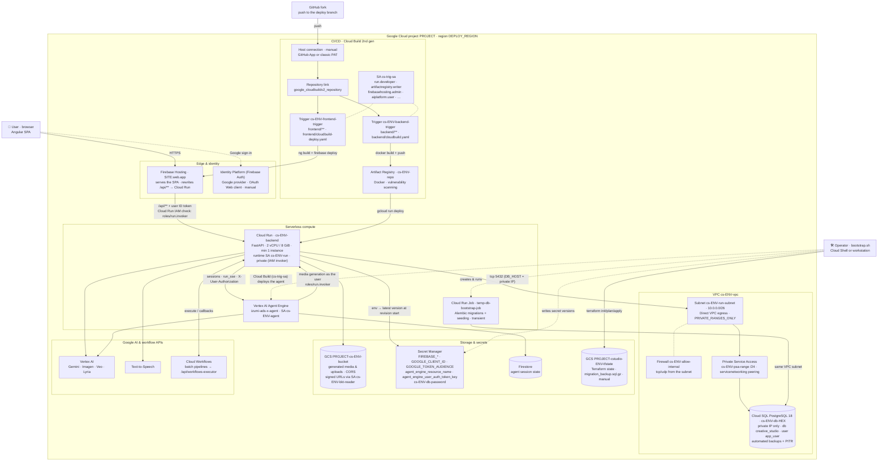

# Creative Studio Infrastructure

This directory contains the Terraform configuration and infrastructure-as-code definitions for deploying Creative Studio on Google Cloud Platform.

## Architecture

Everything below is created by `terraform apply` from this directory (root files `app.tf`, `network.tf`, `storage.tf`, `ci_cd.tf`, `hosting.tf`, `services.tf` and the modules under `modules/`), except the three things marked *manual*: the Cloud Build host connection, the Firebase/Identity Platform set-up and the Terraform state bucket, which [`bootstrap.sh`](../bootstrap.sh) handles around the apply. `ENV` is the environment name (e.g. `dev-infra`), `PROJECT` the project ID, `SITE` the Firebase Hosting site ID (normally the project ID); the exact names of every resource are listed in the [Deployment Guide §1.1](../DEPLOYMENT.md#11-what-gets-created).



How to read it:

- **Request path.** The browser loads the SPA from Firebase Hosting and signs in with Identity Platform. API calls go to `https://SITE.web.app/api/**`, which Hosting rewrites to the Cloud Run service with the user's ID token; the service is **private**, so the caller needs `roles/run.invoker` (see [Deployment Guide §3.3](../DEPLOYMENT.md#33-open-the-app-to-your-users-before-verifying)) and the backend then verifies the token against `GOOGLE_TOKEN_AUDIENCE`.
- **Data path.** The backend reaches Cloud SQL over its private IP through Direct VPC egress (no public IP, no Cloud SQL Auth Proxy), stores media in the asset bucket and hands out signed URLs with `cs-ENV-bkt-reader`, and reads its secrets as environment variables that Cloud Run resolves **only when a revision starts** (hence the backend restart at the end of Step 15).
- **Agent path.** The Workbench talks to the Izumi agent on Agent Engine through the backend; the agent calls the backend's media APIs back as the user (`X-User-Authorization`), which is why `cs-ENV-agent` holds `roles/run.invoker` on the service. Its session state lives in Firestore.
- **Delivery path.** Pushes to the deploy branch of your fork reach Cloud Build through the host connection (the only CI/CD piece you create by hand); the backend trigger builds and pushes the image to Artifact Registry and runs `gcloud run deploy`, the frontend trigger builds the SPA and deploys it to Hosting. Terraform intentionally ignores image changes on the Cloud Run service, so the two never fight.
- **Bootstrap path.** `bootstrap.sh` creates the state bucket, runs Terraform, populates the secrets, creates and runs the migration/seeding job inside the VPC and deploys the agent — see the [Deployment Guide](../DEPLOYMENT.md) for the step-by-step.

## Database Migrations & Safe Upgrades

When making major changes to the database infrastructure (e.g., migrating from an old Public IP setup to a Private IP setup), Terraform must update network settings. This causes a brief window where the active Cloud Run container can no longer connect to the database, resulting in a startup crash that creates a deadlock for Terraform.

To safely prevent this, the `bootstrap.sh` script employs a smart **Migration Flow**:

1. **Step 8 — Backup.** It safely exports your database to the Terraform state bucket as `migration_backup.sql.gz`.
2. **Step 9 — Sever the link.** It deploys a temporary, database-agnostic "dummy" container (`us-docker.pkg.dev/cloudrun/container/hello`) to the Cloud Run backend, completely removing its database dependency.
3. **Step 10 — Apply.** It runs `terraform apply` cleanly without triggering Cloud Run deadlocks.
4. **Step 10 (import) — Restore.** It wipes and recreates the target database, then imports the backup into the newly provisioned instance.
5. **Step 13 — Redeploy.** It triggers Cloud Build to re-deploy your real application code safely.

### How to trigger a Safe Migration

The script employs a hybrid detection mechanism to protect you automatically while keeping the "happy path" silent:

- **Automatic Trigger (V1 Legacy DBs):** If the script detects you are upgrading from an ancient V1 Public IP database (`creative-studio-db` or `creative-studio-db-<hex>`, e.g. `creative-studio-db-6eb3034d`), it automatically pauses and asks if you want to run the migration flow. Answering `n` skips it entirely.
- **Automatic Trigger (Orphaned Backups):** If the script detects a `migration_backup.sql.gz` file sitting in your **Terraform state bucket**, it will ask if you want to restore it using the migration flow. Only that bucket is scanned, because it is the bucket responsible for infrastructure artifacts.
- **Manual Trigger (`--migrate-db`):** If you are intentionally making a dangerous infrastructure change (e.g. changing database regions or network paths manually), you can manually force this safety flow by running:
  ```bash
  ./bootstrap.sh --migrate-db
  ```
  Unlike the automatic triggers, this one intercepts **any** database it finds — public *or* private.
- **Resume from an existing backup (`--use-existing-backup`):** If a previous run already exported the data but `terraform apply` then failed half-way (e.g. the `creative_studio` database was dropped while the instance survived), a new export is impossible. This flag skips the export and runs the migration flow with the `migration_backup.sql.gz` already in the Terraform state bucket:
  ```bash
  ./bootstrap.sh --use-existing-backup
  ```
  Without the flag, if an export fails and that backup exists, the script offers to reuse it instead of aborting.

If you do NOT pass the flag, and the script doesn't detect a legacy database, it assumes a standard "happy path" deployment and relies entirely on Cloud SQL's automated **Point-In-Time Recovery (PITR)**. Steps 8, 9 and the import are all no-ops in that case — zero prompts, zero downtime.

> [!CAUTION]
> Immediately before restoring, the script **drops and recreates** the `creative_studio` database on the target instance. This guarantees a blank schema so the import cannot fail with `relation "..." already exists`. Any data written to the new instance before the restore is discarded in favour of the backup.

> [!NOTE]
> The dummy container is deployed to **both** the legacy backend service name (`cstudio-be`) and the current one (`cs-[ENV_NAME]-backend`). Each is checked for existence first, so nothing is created that did not already exist.

> [!TIP]
> The backup file is intentionally left in the bucket after a successful import as a permanent safeguard. Delete `migration_backup.sql.gz`, or pass `--skip-db-import`, to stop being prompted about it on future runs.

## Izumi Agent

`bootstrap.sh` deploys the Izumi agent exactly as upstream ships it: its Vertex AI endpoint, model IDs and `mediagent_kit` defaults are left untouched (the agent runs on the `global` endpoint). The only location the bootstrap sets is where the Agent Engine resource itself is created (`--location=$DEPLOY_REGION`), since reasoning engines must live in a concrete region.


## Troubleshooting

The full list of known deployment failures and their fixes (Cloud Build connection `409 already exists`, half-failed migrations and `--use-existing-backup`, Cloud Run deadlocks, stale secrets, …) lives in the [Deployment Guide → Troubleshooting](../DEPLOYMENT.md#6-troubleshooting-known-errors-and-fixes).

### Cloud Build host connection

Terraform only **links the repository** (`google_cloudbuildv2_repository.source_repo` in `ci_cd.tf`) to a host connection that must already exist in the deploy region under the name passed as `repo_conn_name`; it never creates the connection. If the console wizard cannot create it (`Error processing oauth callback: Structured justification provided is incorrect`), create it programmatically with a classic GitHub token — the pre-flight, the commands and the fork fallback are in [Deployment Guide §6.16](../DEPLOYMENT.md#616-the-console-cannot-create-the-host-connection-error-processing-oauth-callback-structured-justification-provided-is-incorrect). Never link the repository by hand: a pre-linked repository makes `terraform apply` fail with `409 … already exists`.

### Manual Database Import
If a migration was interrupted, your data is always safe in your project's Terraform state bucket (`gs://[PROJECT_ID]-cstudio-[ENV_NAME]-tfstate/migration_backup.sql.gz`). You can manually restore it via the GCP Console or CLI (drop and recreate `creative_studio` first, see the caution above):
```bash
gcloud sql import sql YOUR_NEW_DB_INSTANCE_NAME \
  gs://YOUR_TF_BUCKET_NAME/migration_backup.sql.gz \
  --database="creative_studio" \
  --project="YOUR_PROJECT_ID"
```
